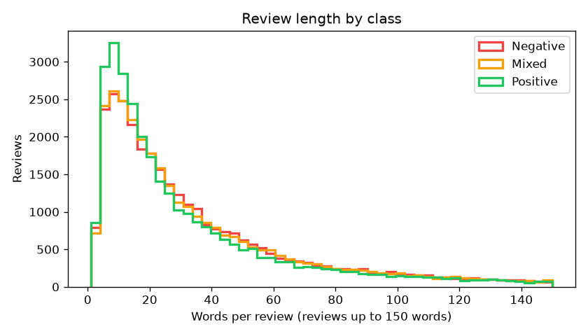
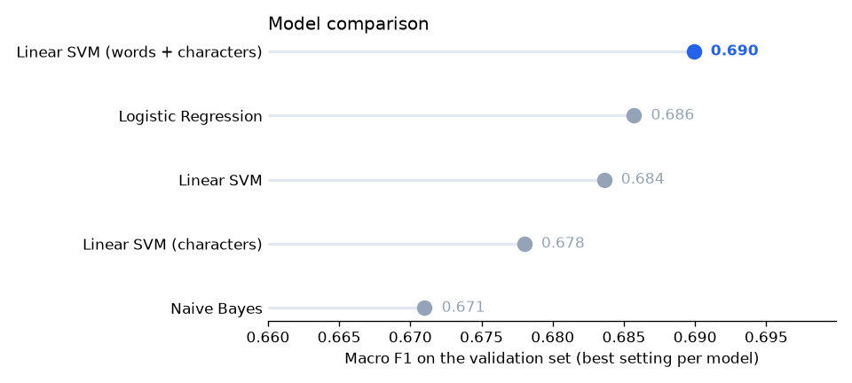
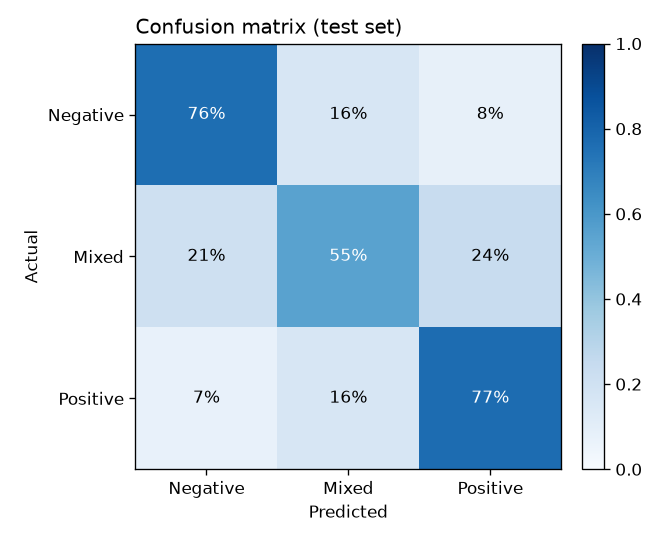

# Arabic Sentiment Analysis

[](https://github.com/eslammohibrahim/arabic-sentiment-analysis/actions/workflows/tests.yml)

This takes an Arabic review and says whether it's positive, negative, or somewhere in between (Mixed). Most of the work went into cleaning up Arabic text and comparing five classic NLP models fairly.

The final model gets 69.2% accuracy (0.689 macro F1) on 19,964 test reviews it never saw. With three balanced classes, guessing would get 33%. It rarely flips a positive review to negative or the other way around (7.5% of the time); most of its mistakes involve the Mixed class.

```text
$ python src/predict.py
Positive  | الفندق نظيف جدا والموظفين محترمين والفطار ممتاز، أكيد هرجعله تاني
Mixed     | المكان حلو بس الخدمة بطيئة والأسعار غالية شوية
Negative  | تجربة سيئة جدا، الغرفة مش نضيفة والتكييف بايظ ومحدش رد علينا
Positive  | الكتاب ممتع وأسلوب الكاتب جميل
Negative  | الرواية مملة ومفيهاش أي جديد، ضيعت وقتي
```

These are sentences I wrote myself in Egyptian dialect as a quick sanity check, not a benchmark.

## Data

[Arabic 100K Reviews](https://huggingface.co/datasets/arbml/arabic_100k_reviews), 99,999 reviews with three balanced classes. It was originally published on Kaggle; this project uses the Hugging Face copy. The data isn't stored in this repo, and `src/data.py` downloads it on first run.

Looking through the data, most reviews turned out to be about books or hotels: book words show up in about 39% of them and hotel words in about 26%. The rest are short or about other things.

The labels look like they come from star ratings rather than from the text. 6.6% of reviews mention stars directly ("نجمتان", "ثلاث نجمات"), and some reviews that are identical after normalization have different labels: "استمتعت به كثيرا" is Positive once and Mixed once. No model can learn that, so it puts a ceiling on accuracy, especially for Mixed.

Length doesn't help tell the classes apart. Positive reviews are a little shorter, but the distributions overlap almost completely.

Cleaning:

| Step | Reviews |
|---|---|
| Raw | 99,999 |
| Empty or too short after normalization | −15 |
| Same text with different labels (can't be learned) | −75 |
| Exact duplicates (kept one copy, so none leak between train and test) | −89 |
| Final | 99,820 |



## Arabic text normalization

Arabic can write the same word in many ways. [`src/preprocess.py`](src/preprocess.py) maps them to one form:

| Step | Example |
|---|---|
| Remove diacritics (tashkeel) | جَمِيلٌ → جميل |
| Remove tatweel (stretching) | رائعــــة → رائعه |
| Unify alef forms | أ إ آ ٱ → ا |
| Unify ya and ta marbuta | ى → ي, ة → ه |
| Collapse repeated letters | حلوووووو جداااا → حلو جدا |
| Convert Arabic digits | ٥ نجوم → 5 نجوم |
| Remove URLs, mentions, punctuation | |

This cut the number of unique words by 36% (418,549 to 268,141). With the same model, validation macro F1 went from 0.679 to 0.684, so a small gain. There are unit tests for each step in [`tests/`](tests/test_preprocess.py).

## Approach

The data is split 64/16/20 into train, validation and test, keeping the same class balance in each. For features I used TF-IDF on words and word pairs (so "لا انصح" and "مخيب للامل" are treated as one unit) and on character n-grams of 2 to 5 characters, which deal better with spelling variants and dialect.

Each model got its own small hyperparameter search on the validation set, so none of them is compared at a bad setting. Then I retrained the best one on train plus validation and ran it on the test set once.

## Results

Validation set, best setting per model:

| Model | Features | Best setting | Macro F1 |
|---|---|---|---|
| Naive Bayes | words | alpha = 3.0 | 0.671 |
| Linear SVM | characters | C = 0.1 | 0.678 |
| Linear SVM | words | C = 0.1 | 0.684 |
| Logistic Regression | words | C = 1 | 0.686 |
| Linear SVM | words + characters | C = 0.1 | 0.690 |



Final model on the test set (19,964 reviews):

| Class | Precision | Recall | F1 |
|---|---|---|---|
| Negative | 0.732 | 0.758 | 0.745 |
| Mixed | 0.630 | 0.552 | 0.589 |
| Positive | 0.705 | 0.767 | 0.735 |
| Overall | | Accuracy 0.692 | Macro F1 0.689 |

Test (0.689) and validation (0.690) are almost the same, so picking the model on the validation set didn't overfit it.



Positive and Negative are rarely mixed up with each other (7 to 8%). Mixed is the hard one and gets confused with both, which makes sense for a review that's partly good and partly bad.

## What the model learned

Words with the strongest weight for each class (word-level Linear SVM, after normalization):

| Class | Top words |
|---|---|
| Positive | استثنائي، رائع، ممتاز، جيد، روعه، اروع، من اجمل، جيد جدا، تحفه |
| Mixed | مرضي، مقبول، حسن، متوسط، لاباس، لكن، ولكن |
| Negative | ضعيف، مخيب للامل، سيئه، اسوا، غير، لم، لا انصح |

I liked seeing "لكن" and "ولكن" near the top for Mixed. People use them when they praise something and then complain. Negation words like "غير" and "لم" lean Negative, and because of the word pairs the model sees "لا انصح" as one thing instead of a separate "لا".

## Error analysis

Some test-set mistakes and why they happen:

| Review | Label | Predicted | Why |
|---|---|---|---|
| كان ليكون كتابا رائعا لو انني قرأته قبل خمسة عشر عاما | Negative | Positive | "Would have been great if...": a bag-of-words model sees "رائعا" but not the condition |
| اقامة فخمه . كل شئ ماعدا التكيييييف. التكيييييييييييييف سئ | Positive | Negative | Overall praise, but one strong complaint dominates the words |
| السلعة سعرها ممتاز وجيدة لا بأس بها | Mixed | Positive | "ممتاز" outweighs the lukewarm "لا بأس بها" |
| الفندق جيد ولكن السعر مرتفع عليه . نعم. المعاملة من بعض الموظفين | Negative | Mixed | The text reads as mixed; the reviewer's rating said negative |
| خفيف جدا .. مسلي أيضا | Negative | Mixed | The text sounds positive; the label likely comes from a low star rating |

The first three are real limits of the model: it can't handle conditionals, and one strong complaint can outweigh general praise. In the last two the text and the rating just disagree.

## Limitations

The labels seem to come from ratings, so some don't match the text and Mixed can't get much better than this. The data is mostly books and hotels, so I don't know how it does on restaurants or apps, and I've only tried Egyptian dialect on a few sentences I wrote. Bag-of-words models also miss word order, sarcasm and conditionals.

## What I'd do next

Fine-tune AraBERT or CAMeLBERT and compare it with this baseline, test on an Egyptian-dialect dataset, and put the model behind a small API.

## Run it

```bash
python -m venv .venv
.venv\Scripts\activate        # on macOS/Linux: source .venv/bin/activate
pip install -r requirements.txt

python src/explore.py         # data stats and the review-length chart
python src/train.py           # downloads the data, compares models, saves the best one (a few minutes on CPU)
python src/predict.py "الخدمة ممتازة والأكل طعمه حلو"
pytest                        # normalization unit tests
```

## Project structure

```
src/
  preprocess.py   Arabic text normalization
  data.py         download, cleaning, deduplication, train/test split
  explore.py      exploratory analysis
  train.py        model comparison, tuning, final evaluation, figures
  predict.py      predictions with the saved model
tests/
  test_preprocess.py
reports/
  figures/        generated charts
  results.json    all metrics, search results, top words, and error examples
```
